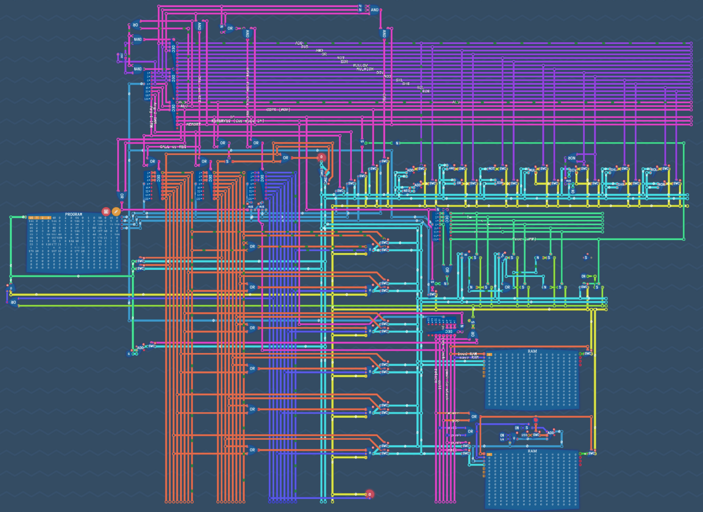

  
  

Hi! I'm Eric Laurence.

I work at Oxen.ai on every layer of the stack. My main areas of focus are our Elixir backend and our machine learning stack (we offer custom [fine tuning](https://docs.oxen.ai/getting-started/fine-tuning) and [inference](https://docs.oxen.ai/getting-started/fine-tuning#deploying-the-model)), but I also help out with our [open source data version control system written in Rust](https://github.com/Oxen-AI/Oxen), the frontend, and infrastructure.

I'm into mathematics, physics, machine learning, and anything nerdy. My favorite programming language is Elixir.

  
  

I'm a huge fan of [Turing Complete](https://store.steampowered.com/app/1444480/Turing_Complete/) and [Zach-likes](https://en.wikipedia.org/wiki/Zachtronics). A couple years ago I played Turing Complete to completion and further got all achievements, including some that have since been removed. Since then, it got an update which took it straight from early access to version 2.0 and broke backwards compatibility. When I have the time, I'm going to go through it again and get all the new achievements. Above is a picture of the LEG architecture, the second CPU architecture you build, from my original playthrough. To my understanding, the design is different in the version 2 update.

I've also designed and built part of a CPU in the [Box2D](https://box2d.org/documentation/) physics engine. I used blocks on path joints to represent bits, with force zones to make the only stable points each end of the track. I ran into limitations of the particular editor I was using which prevented me from implementing conditional logic and memory, but I could push Box2D itself a bit further and probably make it fully turing complete. The biggest challenge will be program memory as simulating the physics gets quite computationally intensive. If I ever get around to it, I might open source the design.
